# ESPHome on the stock Midea dehumidifier Wi-Fi dongle

Run **ESPHome directly on the original Midea Wi-Fi dongle** and control your Midea dehumidifier **100 % locally** from Home Assistant — no Midea cloud, no app account, and **no ESP8266, no ESP32, no level shifter, no USB-A adapter**. The original dongle goes back in its original place; only its firmware changes.

  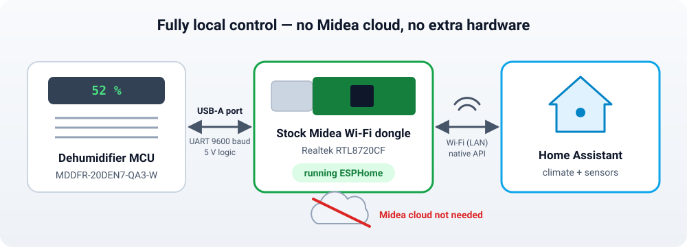

> **Personal project.** I made this because I don't like appliances that can't be controlled locally or that depend on a cloud. It is shared as-is, in the hope it is useful to someone else.

> [!WARNING]
> **Use at your own risk.** Replacing the dongle firmware **voids the warranty** and can damage the dongle or the appliance. I take **no responsibility** for any damage, data loss or malfunction this may cause. Always unplug the dehumidifier from the mains before removing or inserting the dongle. The stock Midea firmware is **not** included here, and once overwritten the dongle will no longer work with the Midea app.

---

## Credits

This builds entirely on the work of others:

- **[Chreece/ESPHome-Dehumidifier](https://github.com/Chreece/ESPHome-Dehumidifier)** — the ESPHome component that speaks the Midea dehumidifier protocol (`midea_dehum`). All the dehumidifier logic is theirs.
- **[Hypfer/esp8266-midea-dehumidifier](https://github.com/Hypfer/esp8266-midea-dehumidifier)** — the original cloud-free firmware and protocol reverse engineering that the component is based on.
- **[sammothxc/midea-sk105-esphome](https://github.com/sammothxc/midea-sk105-esphome)** — showed that this same Midea board (used in their air conditioners) can run ESPHome, and where the download-mode pin is.
- **[LibreTiny](https://github.com/libretiny-eu/libretiny)** and **[ESPHome](https://esphome.io)**, including the [web flasher](https://web.esphome.io/?rtl) with Realtek RTL8720C support.

What this repository adds: the procedure for the **dehumidifier's** stock dongle, a working configuration, and the fixes needed to make it reliable (see [Notes](#notes)).

---

## Tested hardware

| | |
|---|---|
| Dehumidifier | **Midea MDDFR-20DEN7-QA3-W** (20 L/day) |
| Wi-Fi dongle | Midea USB dongle, board **MD_RTL8720_V1.2**, silkscreen `MD-WIFI(RTL8720).JD.TY.MWL.TP1` |
| Chip | **Realtek RTL8720CF** (AmebaZ2, 2 MB flash, ROM v3.0) |
| Protocol | Midea dehumidifier **v1**, UART 9600 baud |
| Software | ESPHome 2026.6, LibreTiny 1.14.0, `midea_dehum` @ `0e46ee1` |

Other Midea / Inventor / Comfee dehumidifiers with the same `MD_RTL8720` USB dongle are likely to work the same way, but they have not been tested.

  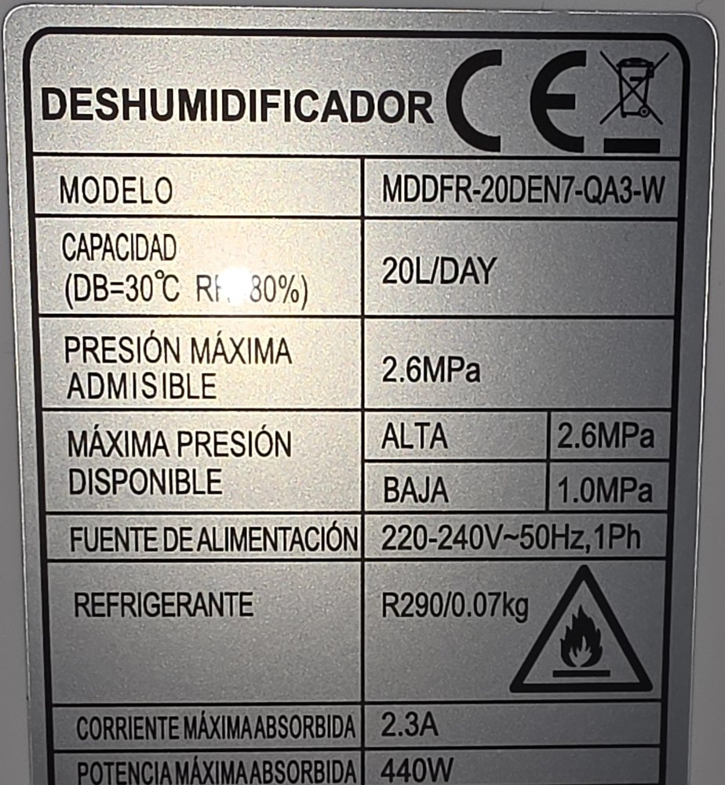
  &nbsp;
  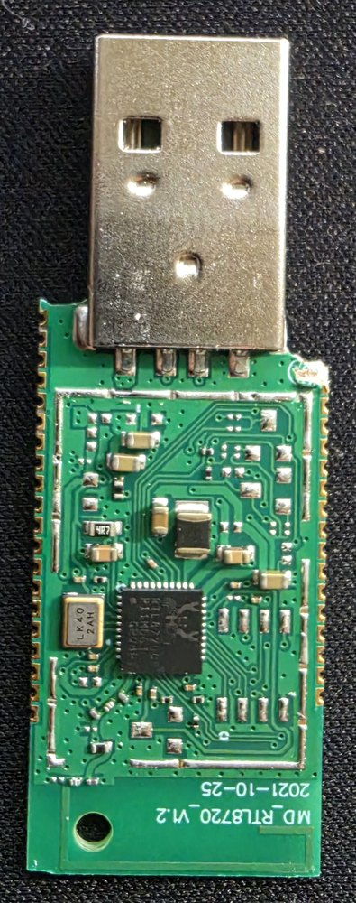
  &nbsp;
  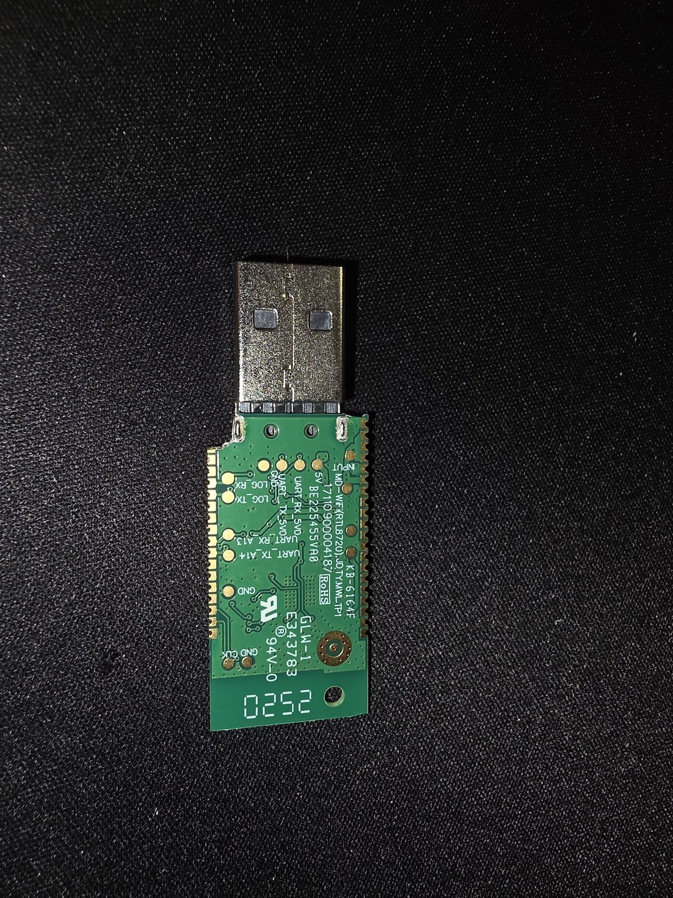

---

## What you need

- The dehumidifier's own Wi-Fi dongle (see [Getting to the dongle](#0-getting-to-the-dongle)) and a Phillips screwdriver.
- A **3.3 V USB-serial adapter** (e.g. an FT232RL board with a 3.3 V / 5 V jumper). It is only needed **once**, for the first flash, and is removed afterwards.
- Five thin wires and a soldering iron (the pads are small but well spaced; temporary wires are fine).
- A computer with **Chrome or Edge** (the flasher uses Web Serial) and ESPHome (the Home Assistant ESPHome add-on / Device Builder, or the ESPHome CLI).

---

## 0. Getting to the dongle

On this model the dongle is **inside the dehumidifier**, plugged into an internal USB-A extension cable that comes from the main board. There is no external USB port.

1. **Unplug the dehumidifier from the mains** and remove the water tank.
2. Remove **6 screws**: **4 at the back**, behind the filter cover, and **2 at the front**, behind the water tank.
3. Lift the cover off. The dongle sits at the top, next to the evaporator coil; unplug it from the internal USB cable.

  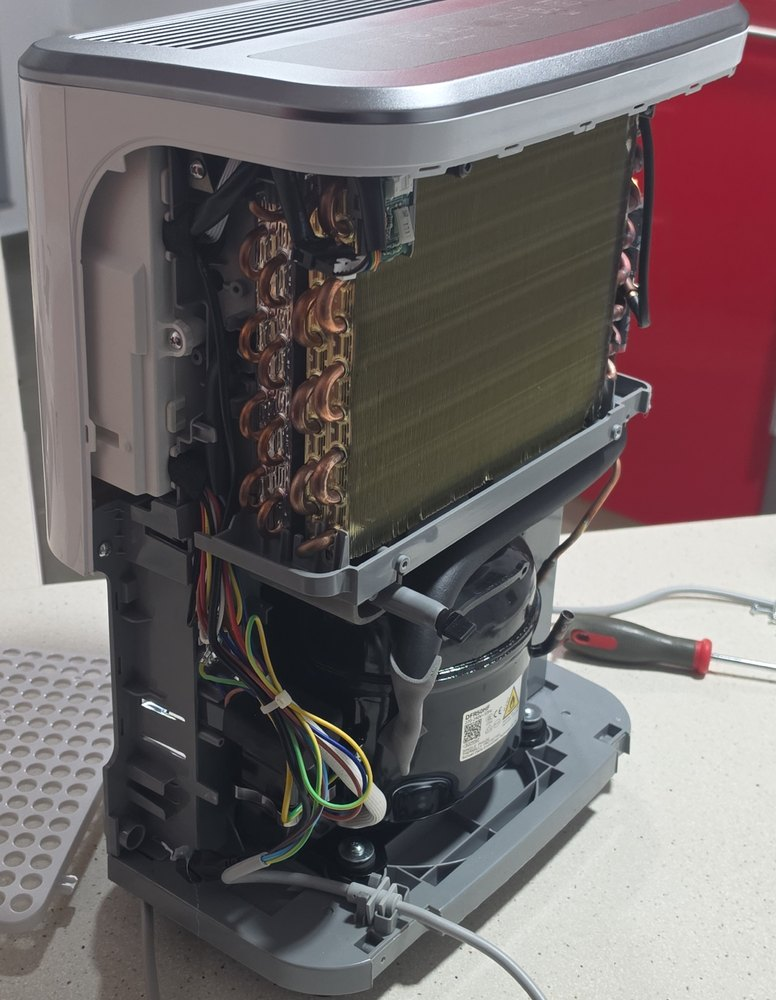
  &nbsp;
  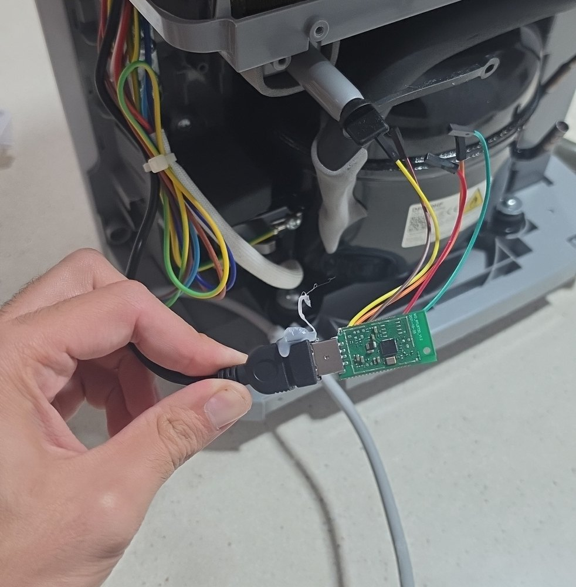

Left: cover removed — the dongle is at the top, next to the coil. Right: the dongle on the internal USB-A extension cable, here still with the flashing wires soldered on.

## 1. Find the pads

All the pads you need are on the **bottom side** of the dongle and are labelled on the silkscreen.

  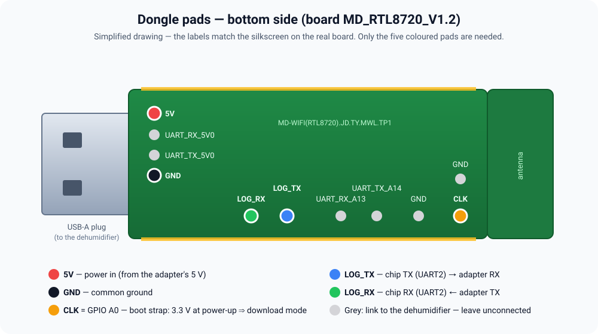

| Pad | Use |
|---|---|
| `5V` | Power input |
| `GND` | Ground |
| `LOG_TX` | Chip TX (UART2, flashing and logs) |
| `LOG_RX` | Chip RX (UART2) |
| `CLK` | Chip pin **A0**: held at **3.3 V during power-up** it starts the ROM **download mode** |
| `UART_RX_A13`, `UART_TX_A14`, `UART_*_5V0` | Link to the dehumidifier — leave them alone |

## 2. Build the firmware

1. Copy [`esphome/midea-dehumidifier.yaml`](esphome/midea-dehumidifier.yaml) into your ESPHome configuration and add the secrets from [`esphome/secrets.example.yaml`](esphome/secrets.example.yaml).
2. Compile it and download the firmware **`.uf2`** file (in the ESPHome dashboard: *Install → Manual download*; with the CLI: `esphome compile midea-dehumidifier.yaml`, the file ends up in `.esphome/build/<name>/.pioenvs/<name>/firmware.uf2`).

## 3. Wire it and enter download mode

  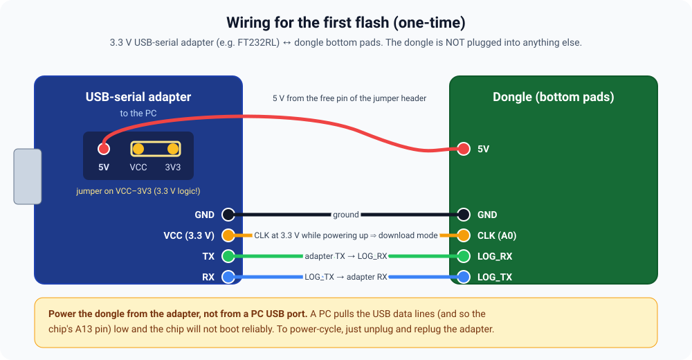

1. Set the adapter jumper to **3.3 V** (VCC–3V3). The TX/RX logic must be 3.3 V.
2. Connect: adapter **5V** (the free pin of the jumper header) → `5V`, **GND** → `GND`, **TX** → `LOG_RX`, **RX** → `LOG_TX`, **VCC (3.3 V)** → `CLK`.
3. Plug the adapter into the computer. The dongle powers up with `CLK` high and starts in **download mode**.

  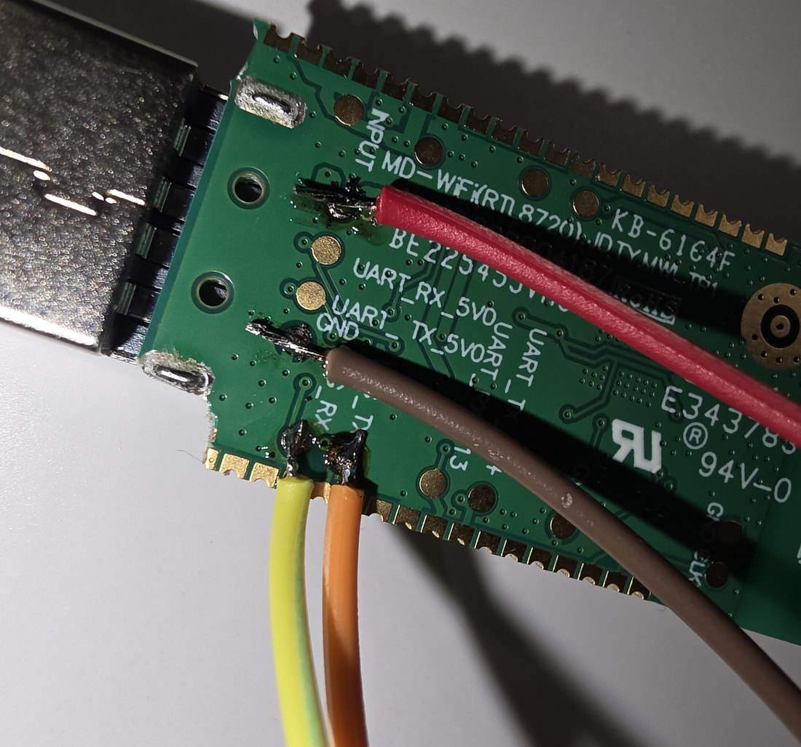

The wiring actually used: 5V (red), GND (brown), LOG_RX and LOG_TX (yellow and orange). The CLK wire goes to the far end of the board, out of frame.

> [!IMPORTANT]
> Power the dongle from the adapter, **not by plugging the dongle into a PC USB port**. A PC pulls the USB data lines low — on this board that pulls the chip's A13 pin low and it will not boot reliably. To power-cycle, simply unplug and replug the adapter.

## 4. Flash with the ESPHome web flasher

  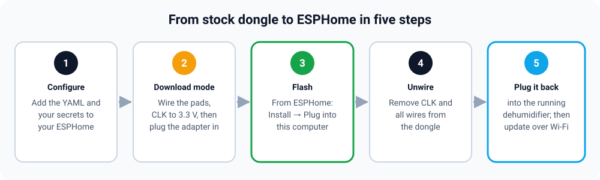

1. Open **[web.esphome.io/?rtl](https://web.esphome.io/?rtl)** in Chrome or Edge.
2. *Connect* and choose the adapter's serial port.
3. Choose the `.uf2` from step 2 and install it.

The flasher links to the chip's ROM downloader, writes the **partition table, the bootloader and the application**, and verifies each part — every write should end with `Verified … (SHA-256 matches)`. It worked on the first try.

## 5. Back into the dehumidifier

1. Remove the `CLK` wire (otherwise the chip keeps booting into download mode) and all the other wires.
2. Plug the dongle back into the internal USB cable, put the cover back and tighten the 6 screws.
3. Plug the dehumidifier in and switch it on. The dongle joins your Wi-Fi and Home Assistant should discover it as a new ESPHome device (enter the API encryption key from your secrets). From now on, **updates are done over Wi-Fi** like any other ESPHome device.

---

## Home Assistant

| Entity | Notes |
|---|---|
| `climate` **Dehumidifier** | `off` / `dry`; presets (modes); target humidity 30–80 %; fan `low` / `medium` / `high`; current humidity and temperature |
| `binary_sensor` Tank full, Defrosting | |
| `sensor` Humidity, Temperature, Error code | |
| `text_sensor` Capabilities | What the appliance reports, e.g. `Fan speed control, Auto humidity control, Clothes Drying` |
| `number` Timer | |
| `switch` Beep on commands | |

### Modes

The four modes were matched one by one against the LEDs on the control panel:

  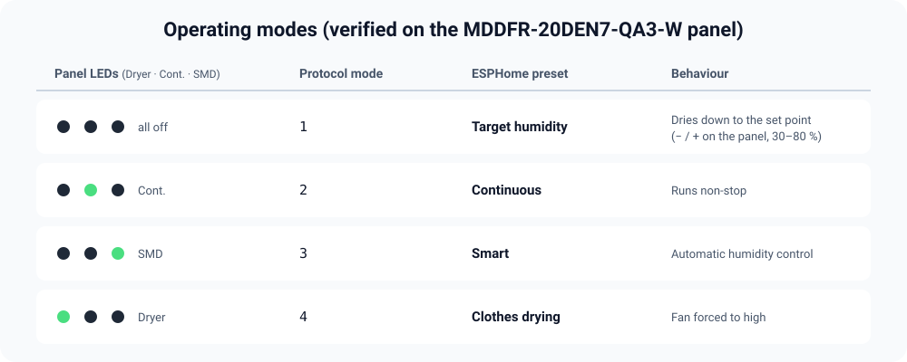

  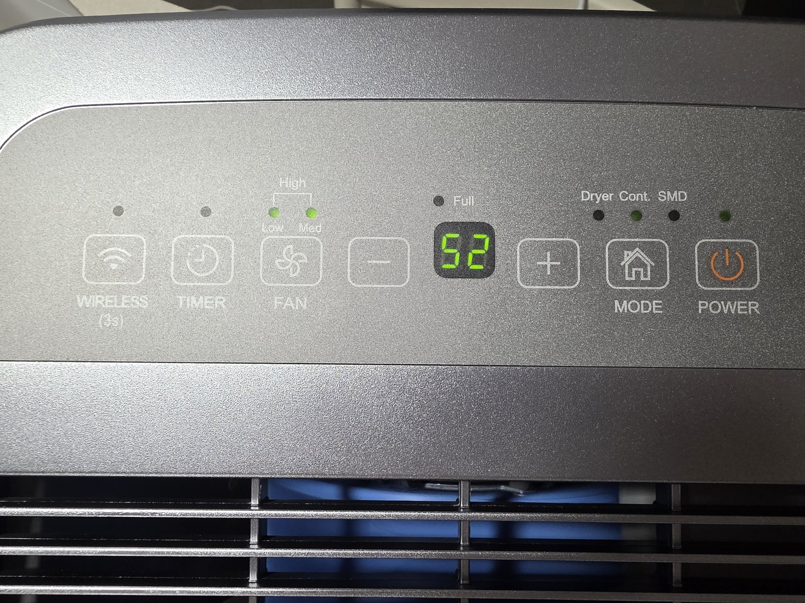

---

## Notes

- **No ionizer.** This model reports only three capabilities (fan speed `0x10`, auto humidity `0x1F`, clothes drying `0x20`), so the ionizer switch is left out of the configuration.
- **Protocol v1.** Auto-detection (`protocol_version: 0`) found v1 on the first boot; it is then fixed in the YAML so the dongle does not need to detect it every time.
- **LibreTiny 1.14.0 or newer.** With older versions the RTL8720CF can hang on a software reboot ([libretiny#396](https://github.com/libretiny-eu/libretiny/issues/396), fixed in [#397](https://github.com/libretiny-eu/libretiny/pull/397)), so the dongle would not come back after an OTA update until it was unplugged. The YAML pins the framework version.
- **Handshake watchdog.** After a power cut the dongle and the appliance start at the same time. If the dongle greets the appliance before its main board is ready, the component's handshake is lost and it never polls again, so Home Assistant keeps showing *off*. The `interval:` block in the YAML retries the handshake and, after about 40 seconds, polls the status anyway — this model answers status queries even when the handshake never completes.
- **`hvac_action` flickers** between *idle* and *drying* on each update while the appliance is running. It is cosmetic: the on/off state, mode, humidity and fan are correct.
- **Board variant.** `generic-rtl8720cf-2mb-896k` puts the application at `0x10000`, like the stock firmware. The web flasher writes its own partition table and bootloader, so other RTL8720CF variants should work too; this is the one that was tested.

## Troubleshooting

| Symptom | Fix |
|---|---|
| The flasher cannot connect | Check that `CLK` is at 3.3 V **before** the adapter is plugged in, and that TX/RX are crossed (adapter TX → `LOG_RX`). Unplug and replug the adapter. |
| The dongle boot-loops or behaves randomly while flashing | It is being powered from a PC USB port. Power it from the adapter's 5 V instead. |
| After flashing, nothing happens | `CLK` is still at 3.3 V: remove that wire and power-cycle. |
| Home Assistant shows *off* while the appliance runs | Wait about 40 s after the dongle boots (handshake watchdog). Check the logs for `Handshake not complete; retry`. |
| No reply from the appliance at all | Make sure the dehumidifier is switched on, then unplug and replug the dongle. |

---

## License

The configuration, diagrams and documentation in this repository are released under the [MIT License](LICENSE). The `midea_dehum` component is © its authors and licensed separately (Apache-2.0). Midea is a trademark of its owner; this project is not affiliated with or endorsed by Midea.
